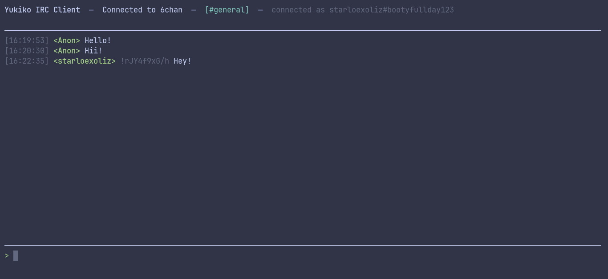

# Yukiko 🎀

A terminal IRC client for 6chan's `#general` and `#staffs` chat.

[](https://ratatui.rs/)

## Build

Prerequisites:

- rust

```bash
cargo build --release
```

## Configure

Configure files are usually located in `/yukiko/config.toml` in your OS filesystem.

For Windows its in `AppData`, for Linux its in `~/.config/`.

```bash
yukiko config set-server http://localhost:8080
yukiko config set-name "anon#mypassword"
yukiko config show
```

Resolution order for both server and name: `--server`/`--name` flag on
`start` > config file (`~/.config/yukiko/config.toml`) > built-in default
(`http://localhost:8080`, name `Anon`).

## Daemon

Run one background process that polls the server, and let any number of
`yukiko start` windows attach to it instead of each polling separately:

```bash
yukiko daemon --channel=#general,#staffs
```

Then in another terminal (or several):

```bash
yukiko start --channel=#general,#staffs
```

`start` tries `127.0.0.1:7878` first; if a daemon answers, it attaches and
does no HTTP polling of its own. If nothing's listening there, it falls
back to polling directly — same as before the daemon existed. Nothing
about this touches your web server config: the daemon's socket is
loopback-only, unrelated to whatever serves the PHP site on 8080.

Override the port with `--port` on either command, or persist one via
`yukiko config` (not yet exposed as a `set-` subcommand — edit
`daemon_port` in `config.toml` directly for now).

## Run

Once you've installed or build the IRC client, you can run it by:

```bash
yukiko start --channel=#general
yukiko start --channel=#general,#staffs
```

And it should render:



## Slash commands

- `/nick <name>` - change your display name (persists to config too)
- `/join <#channel>` - open a new tab, starts polling/subscribing to it
- `/part [#channel]` - close a tab (defaults to the active one; refuses to close your last one)
- `/me <action>` - sends `*name action*` as a normal message
- `/friend <name or !tripcode>` - color someone gold in the message pane and user list, persists to config
- `/unfriend <name or !tripcode>` - remove a friend
- `/send <local file path>` - upload a file (5MB max); everyone in the channel sees a 📎 line
- `/getfile <id> [folder]` - download a shared file (id comes from the 📎 line), saved to `./yukiko-downloads` by default
- `/settings` - toggle the settings screen (same as pressing it in the tab bar)
- `/quit` - same as Esc/Ctrl+C
- `/help` - lists all of the above, shown as a local system message (never sent to the server)

Friend matching uses whatever you already see: type the exact tripcode
(with the `!`) to match by tripcode, or the plain name to match by name —
same key the color hashing itself uses.

## Keys

- Type to compose, `Enter` to send (goes to whichever tab is active)
- `Tab` / `Shift+Tab` - switch channel tabs
- `PageUp` / `PageDown` - scroll back / forward through history
- `End` - jump back to the live bottom of the current channel
- `Esc` or `Ctrl+C` - quit

## License

Under the MIT License.
