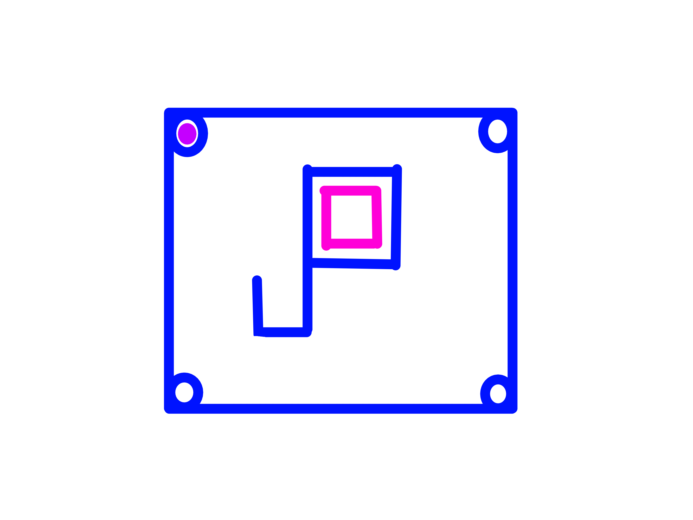

# 🧸 Pioneer



**Pion**eer is a <span style="color:pink;">webRTC</span> livestreaming platform
for the moderators / staffs of <u>6chan</u>.

Named after the Go service **Pion** which is literally where this platform is built on and **eer** means **Peers**.

Also uses <span style="color:skyblue;">PocketBase</span> as the main database for real-time subscribing to the website.

> [!WARNING]
> This project is ongoing development, still experiencing updates and bugs, and also please feel free to contribute :,)

## Build

Step 0: Setting things up

```bash
go mod tidy
```

Step 1: Compile the <span style="color:lime;">server.</span>

> [!NOTE]
> You might want to locate the executable in the root `bin/` directory for quickly navigating it.

```bash
go build -o ../../../bin/pioneer.exe
```

Step 2: Run the server

```bash
./pioneer.exe
```

Should output or log when going live:

```txt
Pioneer relay listening on :8088

2026/09/20 17:15:13 mod admin went live (title="live today")
2026/09/20 17:21:22 stream ended
```

## PocketBase

Run the <span style="color:skyblue;">PocketBase</span> executable, open `/_/` admin UI, and create one collection:

## `chat_messages`

| FIELD          | TYPE  | NOTES                           |
|----------------|-------|---------------------------------|
| `body`         | TEXT  | REQUIRED, max length 300        |
| `display_name` | TEXT  | OPTIONAL, max length 24         |

Leave `id` and `created` as PB's defaults, the frontend sorts by `created`.

### API Rules

- **List/Search rule**: leave empty (public read)
- **View rule**: leave empty (public read)
- **Create rule**: leave empty (public create - anyone can post, no auth)
- **Update rule**: `` (blank = nobody, not even the creator, can edit - leave locked)
- **Delete rule**: set to your mod auth condition if you want mods to be able
  to delete messages from the PB admin UI directly; otherwise leave locked
  and moderate from the admin panel

## License

GNU Affero General Public License v3 (aGPLv3)
